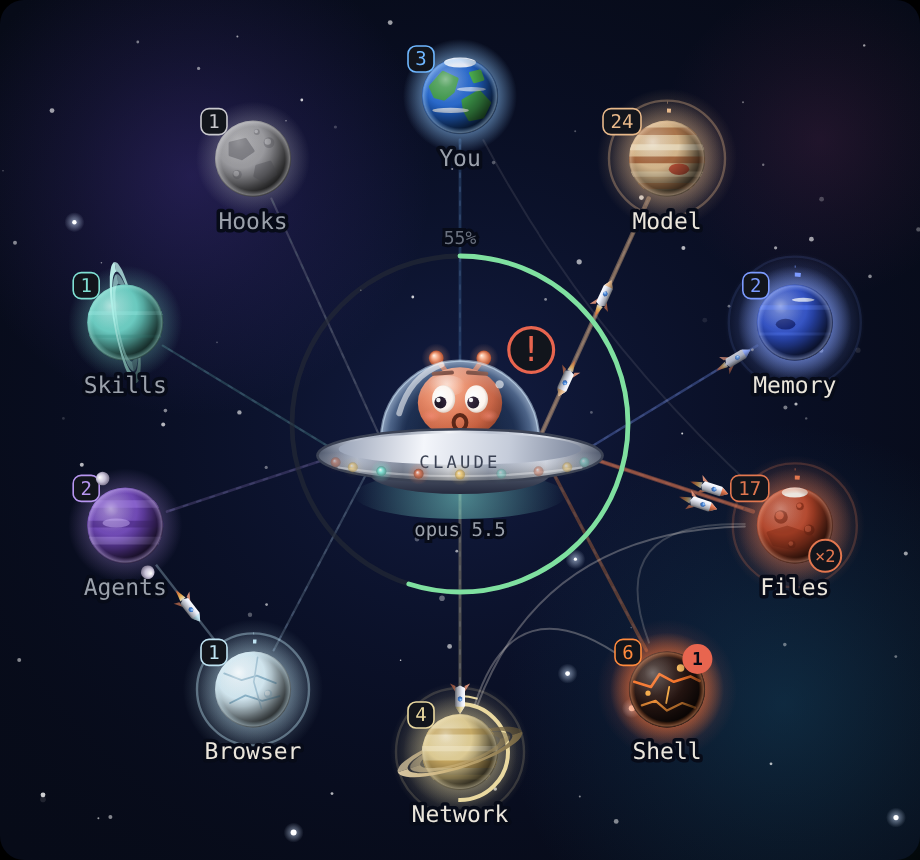
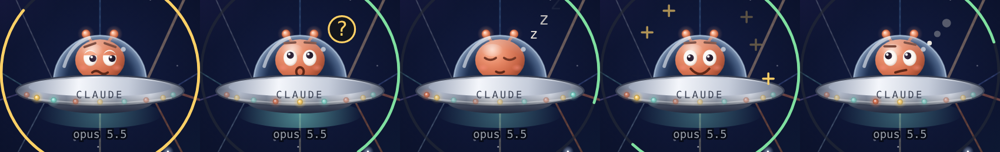

# alien-map

A space-themed live map of Claude Code's work, in a pane beside the chat, drawn in a lit, 3D-render style. An orange alien flies a UFO in the middle. Each kind of work is a planet. Every tool call is a tiny rocket that leaves the saucer, docks at its planet while the call runs, and flies home when it ends.

Built on [lot-map](https://github.com/alexeyw/lot-map) by Aleksei Volodin (MIT). The hooks, the privacy rules and the options are lot-map's. The drawing and the models column are new.



## Install

From a shell, with this folder on your computer:

```bash
claude plugin marketplace add /path/to/alien-map
claude plugin install alien-map@alien-map
```

Then start a new session. The pane opens by itself. If it doesn't, type `/alien-map`.

To try it for one session without installing:

```bash
claude --plugin-dir /path/to/alien-map
```

If you also have lot-map installed, disable one of them. Both watch the same hooks.

## The look

Everything round is lit from the upper left: each planet has its own colors and surface, a night side, a bright spot where the light strikes, a thin rim of light and a halo of air. The alien's head and eyes are glossy, the dome is glass, the saucer is brushed metal with glowing beads round its rim, and every rocket is shaded round its hull. All of it is SVG gradients, so it stays sharp at any size.

## The planets

| Planet | Station | What lands there |
| --- | --- | --- |
| Earth | You | your messages, questions to you, things to approve |
| Jupiter | Model | each model step, compaction |
| Neptune | Memory | Claude Code's memory folder, plus any memory tools you name |
| Mars | Files | Read, Write, Edit, Grep, Glob, file-only shell commands |
| Lava world | Shell | every other shell command |
| Saturn | Network | web fetch and search, MCP servers, `curl`, `gh`, `git push` and the like |
| Ice moon | Browser | browser tools |
| Violet giant | Agents | subagents and background work (each live subagent is a moon circling it) |
| Uranus | Skills | skills, tool search |
| The Moon | Hooks | settings hooks that refuse, ask, or add context |

Each planet has a count in its top-left corner. A red badge in the top right counts errors until your next message. `×3` at the bottom right means three calls are running there at once.

## The alien



* **Working:** watches the planet whose call is running.
* **Idle:** every 14 seconds it glances at two planets, with one brow raised, a sideways mouth and thought dots.
* **Something failed:** a surprised "o" and a red `!`, for 6 seconds.
* **Waiting on you:** a surprised "o" and a yellow `?`, until you answer.
* **Answer ready:** a grin and sparkles, for 4.5 seconds.
* **Context at 80% or more:** worried brows, a wavy mouth, heavy lids, darting eyes and a sweat drop.
* **Two quiet minutes:** dozes off with drifting z's (never while worried).

The timed moods are written into the drawing itself, so they start and stop on time even when nothing redraws the pane.

## Under the map

Two columns:

* **Activity:** the last rows of work, same as lot-map.
* **Models:** each model that took a step this session, with how many. A model lights up while its step runs.

In a terminal the models show on one line under the station tally.

## Also

* The ring around the UFO is the context window. It turns amber at 70% and red at 90%.
* The lanes from the saucer to each planet get thicker and take the planet's color as it's used.
* A thin line traces the main loop's route between planets and fades after a minute.
* Space stays dark on every theme. `colors` still works for text, labels, errors and the route, and `background=#rrggbb` gives a plain ground.
* `motion: reduced` stops the rockets, twinkles, glances and blinks. Rockets show parked at the planet whose call runs.
* `terminalView: picture` paints the same space map in terminals that show pictures (iTerm2, kitty, Ghostty). The painter now fills shapes and gradients, so the planets keep their light and shade. The sky behind is drawn plain there to keep each frame near 250 KB.

The rest of lot-map's options work as before: language, memory servers and commands, hook reasons, subagent names, layout, text size and braille. See lot-map's README for the full list.

## Privacy

Unchanged from lot-map. The mod makes no network requests, reads no files and runs no processes. A label holds a name, never content. The one new thing kept is each model step's short model name (such as `opus 5.5`), for the models column, and only for the session. See [PRIVACY.md](PRIVACY.md) and [PRINCIPLES.md](PRINCIPLES.md), written for lot-map. They still apply.

## Tests

```bash
claude plugin validate .
claude plugin test .
```

All 133 tests pass on Claude Code 2.1.325, including new ones for the rockets, the moods and the models column.

## License

MIT. Original lot-map copyright Aleksei Volodin; see [LICENSE](LICENSE).
